# AI 8-Puzzle Visualizer — Uniform Cost Search

An interactive web application that solves the **8-Puzzle** with **Uniform Cost Search (UCS)** and shows, step by step, how the search works: which node is expanded, which successors are generated, and how the frontier (open list) and explored (closed list) change until the goal is reached.

> **Course:** Artificial Intelligence · **Assignment:** Interactive 8-Puzzle Problem Solver using AI Search Algorithms (Case Study, 10 marks)
> **Assigned algorithm:** No. 5 — Uniform Cost Search

| | |
|---|---|
| **Live site (GitHub Pages)** | `https://dev-sathasivam18.github.io/AI-8Puzzle-Visualizer/` |
| **Repository** | `https://github.com/dev-sathasivam18/AI-8Puzzle-Visualizer` |
| **Demo video** | _add your link here_ |

---

## Project description

The 8-Puzzle is modelled as a state-space search problem:

| Element | Definition |
|---|---|
| State | 3 × 3 arrangement of tiles 1–8 and a blank |
| Actions | Move the blank **Up / Down / Left / Right** (2–4 legal moves per state) |
| Step cost | **Unit cost only** (every move = 1) |
| Goal test | Current state equals the goal state (applied when a node is *popped*, which makes UCS optimal) |

UCS is implemented **from scratch** (`js/ucs.js`) with its own binary min-heap (`js/heap.js`). The search first runs to completion and records a compact trace of every expansion; the visualiser then **replays that trace forwards and backwards**, so the animation always shows exactly what the real algorithm did.

### Pages

| Page | What it contains |
|---|---|
| **Home** (`index.html`) | Course, assignment title, student name, registration number, introduction to the 8-Puzzle, navigation |
| **Solver** (`solver.html`) | Puzzle input (manual + random solvable), fixed Uniform Cost Search, animated board, live search process, solution summary, solution path, interactive controls |
| **Comparison** (`compare.html`) | BFS, DFS, DLS, IDDLS, UCS, GBFS and A\* run on the same puzzle — nodes, moves, cost, time, memory |
| **Algorithms** (`algorithms.html`) | Description, working principle, advantages, limitations, time/space complexity, completeness and optimality of each algorithm |

### Features

- **Two ways to create a puzzle** — type the initial and goal states, or press **Generate Random Puzzle** (easy / medium / hard; always solvable). Unsolvable inputs are detected through inversion parity and reported as *Not Found*.
- **Animated blank-tile movement** — tiles slide into the gap; the blank is drawn as a dashed square so you can follow it.
- **Search process shown live** — current node, parent node, generated successors (with *new / cheaper path found / already explored / duplicate* labels), frontier (cheapest first), explored list, nodes generated / expanded, current and maximum depth, path cost g(n), f(n) = g(n).
- **Solution summary** — found / not found, total moves, nodes generated, nodes expanded, maximum depth, execution time, path cost, approximate memory.
- **Controls** — Run, Pause, Resume, Next Step, Previous Step, Reset, Skip, and a speed slider (1 → 3000 expansions per second).
- **Fixed assigned method** — the solver runs Uniform Cost Search only, with every move assigned a unit cost of 1.
- Responsive layout, light/dark theme, keyboard-accessible inputs.

---

## Technologies used

- HTML5, CSS3, JavaScript (ES6) — no build step, no framework needed
- [Bootstrap 5.3](https://getbootstrap.com/) (CDN) for layout and components
- CSS transforms/transitions for tile animation
- Node.js (optional) only to run the unit tests in `tests/`

## Search algorithms implemented

| Algorithm | Where | Purpose |
|---|---|---|
| **Uniform Cost Search** | `js/ucs.js` | The assigned algorithm — fully implemented and visualised |
| BFS, DFS, DLS, IDDLS, GBFS, A\* | `js/reference-algorithms.js` | Compact reference versions used **only** by the Comparison page so every algorithm can be benchmarked on the same puzzle. They are not visualised. |

### UCS in brief

Step 3 is informational rather than a selector: UCS is used directly, and every move has unit cost 1.

1. Frontier = min-heap ordered by path cost g(n) (ties broken first-in-first-out); explored = set of expanded states.
2. Pop the cheapest node. If it is the goal → stop (goal test on expansion).
3. Otherwise expand it. For each successor: skip it if already explored; add it if new; **replace** the frontier entry if this path is cheaper (lazy deletion of the old heap entry).
4. Repeat until the goal is popped or the frontier is empty.

Counting conventions used throughout the app: *nodes generated* = root + every successor produced (duplicates included); *nodes expanded* = nodes popped and expanded (the goal is tested, not expanded); *memory* = peak (frontier + explored) nodes × 64 bytes — an estimate, not a measurement.

## Heuristics used

UCS is uninformed and uses **no heuristic**. The heuristics below are used by GBFS and A\* **on the Comparison page**:

- **Manhattan Distance** — sum over all tiles of |Δrow| + |Δcol| to the goal cell
- **Misplaced Tiles** — number of tiles (blank excluded) not in their goal cell

Both are admissible and consistent.

## Screenshots

Add your screenshots to the `images/` folder and link them here:

| Home | Solver |
|---|---|
| `` | `` |

| Search process | Comparison |
|---|---|
| `` | `` |

## How to run the project

**Option 1 — just open it.** Double-click `index.html` (needs internet for the Bootstrap CDN).

**Option 2 — local server** (recommended):

```bash
cd AI-8Puzzle-Visualizer
python -m http.server 8000      # then open http://localhost:8000
```

**Run the tests** (optional, needs Node.js):

```bash
node tests/test-ucs.js
node tests/test-reference.js
```

### Deploy on GitHub Pages

1. Create a repository named `AI-8Puzzle-Visualizer` and push this folder to the `main` branch.
2. Repository → **Settings → Pages**.
3. *Source:* **Deploy from a branch** → branch `main`, folder `/ (root)` → **Save**.
4. The deployed site is available at `https://dev-sathasivam18.github.io/AI-8Puzzle-Visualizer/`.

## Repository structure

```
AI-8Puzzle-Visualizer/
├── index.html              Home page
├── solver.html             Solver + visualisation
├── compare.html            Comparison page
├── algorithms.html         Algorithm information page
├── css/style.css           Custom styles (on top of Bootstrap)
├── js/
│   ├── config.js           ← your name / reg. no. (edit this)
│   ├── common.js           Navbar, footer, theme, shared storage
│   ├── heap.js             Binary min-heap (priority queue)
│   ├── puzzle.js           8-puzzle model, successors, solvability, heuristics
│   ├── ucs.js              Uniform Cost Search (assigned algorithm)
│   ├── reference-algorithms.js   BFS/DFS/DLS/IDDLS/GBFS/A* for the comparison page
│   ├── board.js            Animated board + mini boards
│   ├── solver.js           Solver page controller (replay engine, rendering, controls)
│   ├── compare.js          Comparison page controller
│   └── algorithms.js       Algorithm information content
├── tests/                  Node.js self-checks
├── docs/                   Design notes + demo-video script
├── assets/  images/        Static resources / screenshots
└── README.md
```

## Student details

| | |
|---|---|
| Name | S. SATHASIVAM |
| Registration number | 24BCE2650 |
| Course | Artificial Intelligence |
| Assigned algorithm | Uniform Cost Search (No. 5) |

## References

1. S. Russell and P. Norvig, *Artificial Intelligence: A Modern Approach*, 4th ed., Pearson — Chapter 3 (Solving Problems by Searching), uniform-cost search and the 8-puzzle.
2. E. W. Dijkstra, "A note on two problems in connexion with graphs", *Numerische Mathematik* 1, 1959 — the basis of uniform-cost search.
3. Bootstrap 5.3 documentation — <https://getbootstrap.com/docs/5.3/>
4. MDN Web Docs — CSS Transforms and Transitions — <https://developer.mozilla.org/>
5. Solvability of the 8-puzzle (inversion parity) — Johnson & Story, "Notes on the 15 puzzle", *American Journal of Mathematics* 2, 1879.

## Screenshots

### 1. Project Structure
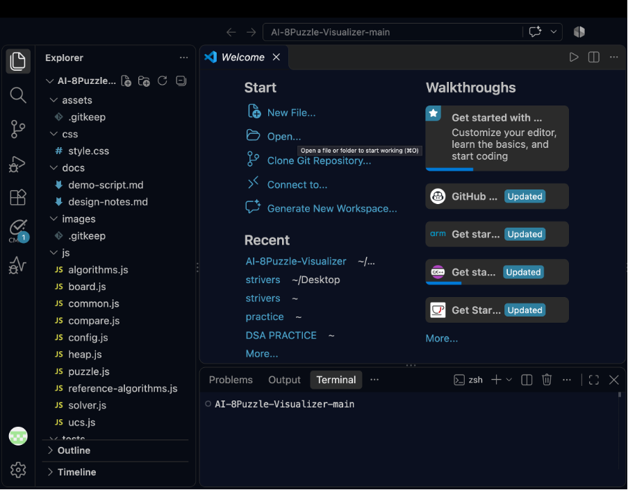

### 2. Local Server Running
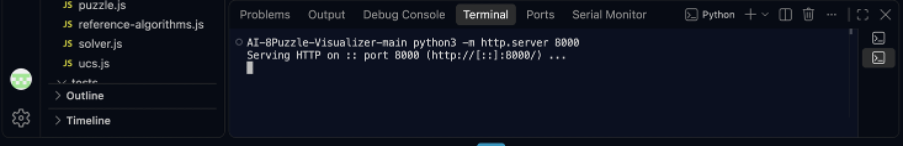

### 3. Homepage
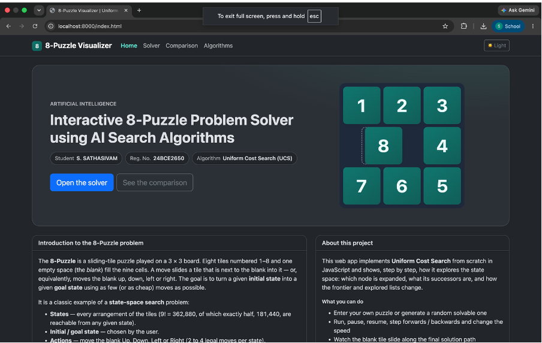

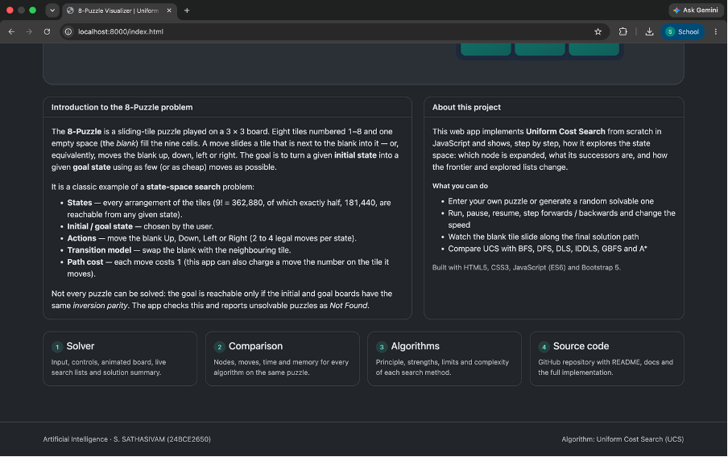

### 4. UCS Solver
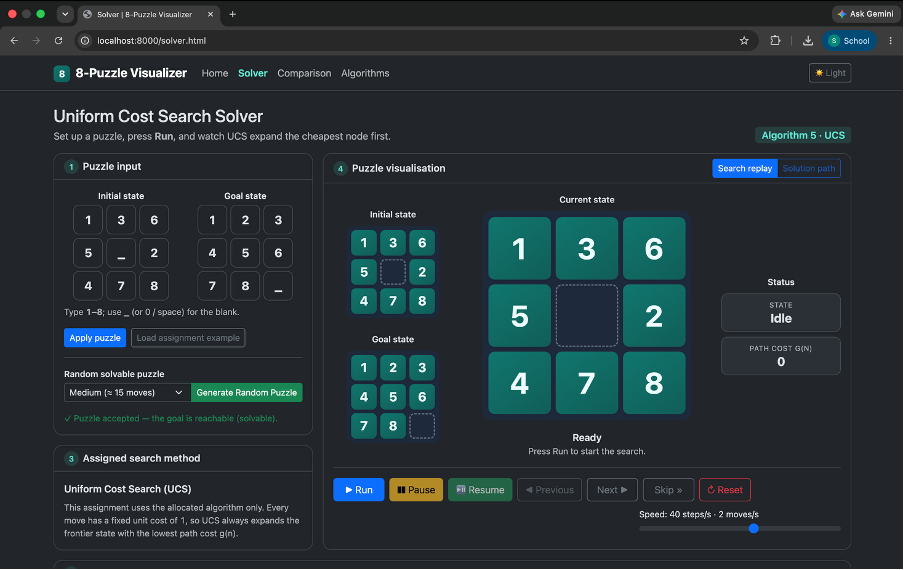

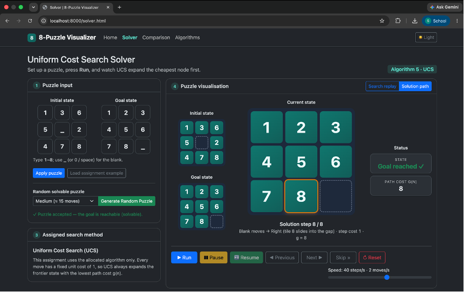

### 5. UCS Solution Summary
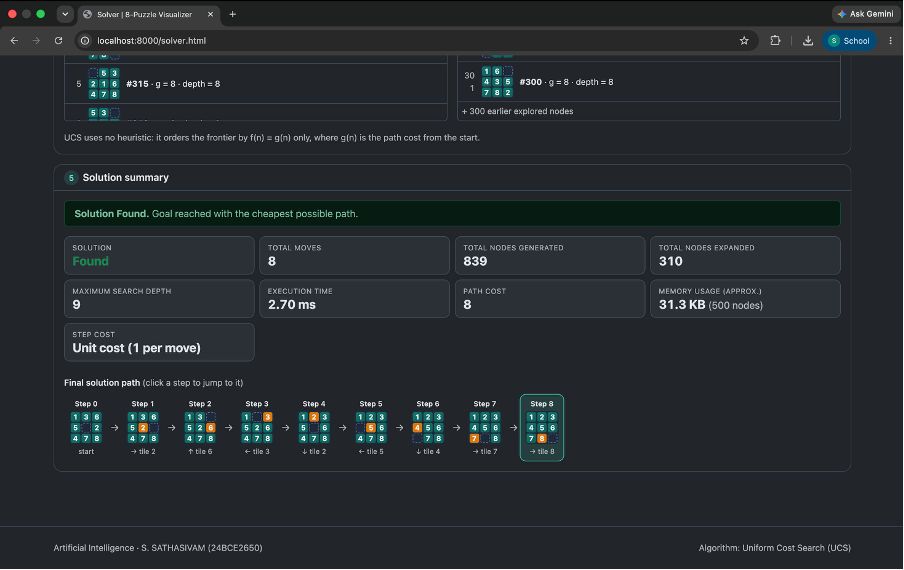

### 6. Live Search Process
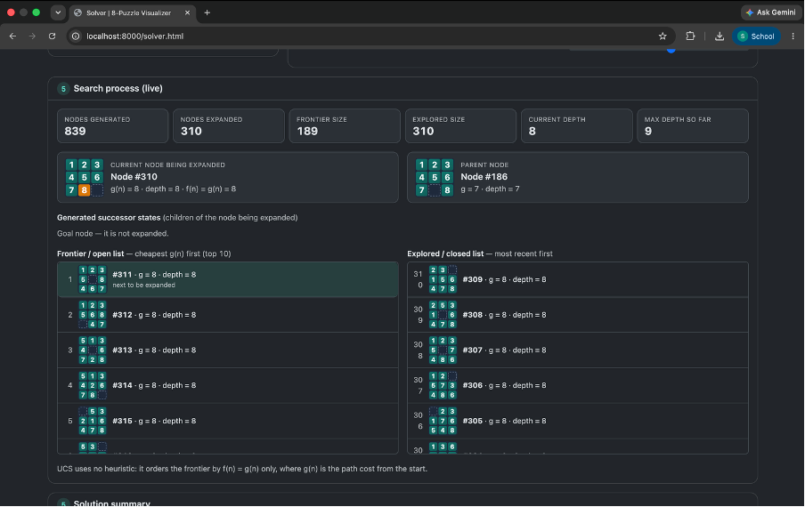

### 7. Algorithm Comparison
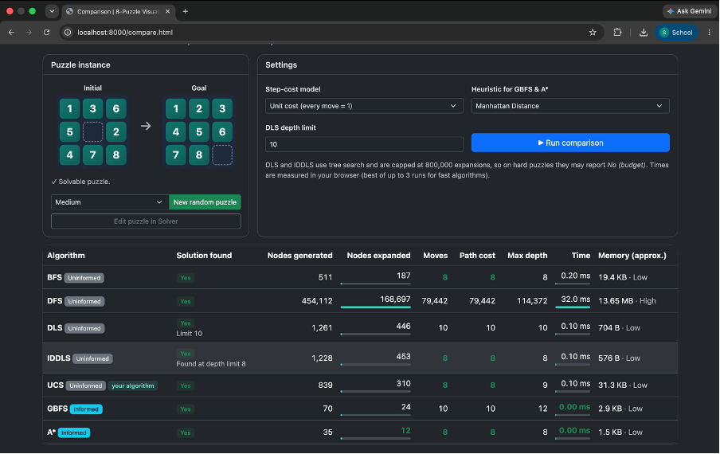

### 8. Heuristic Settings
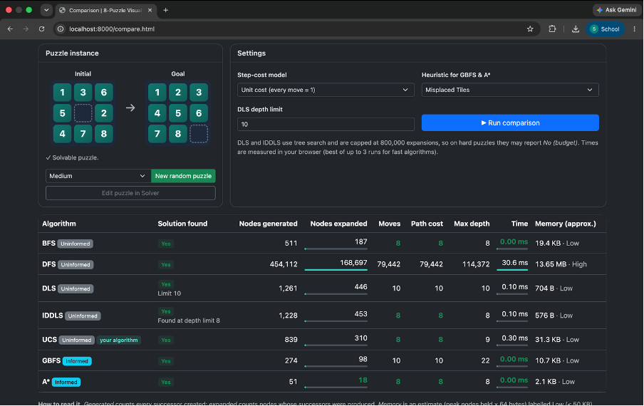

### 9. Random Puzzle Difficulty Levels
**Easy**
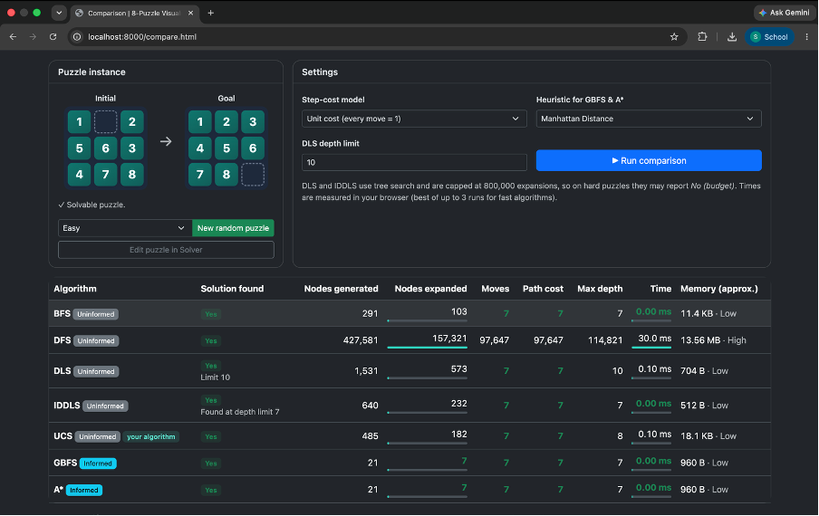

**Medium**
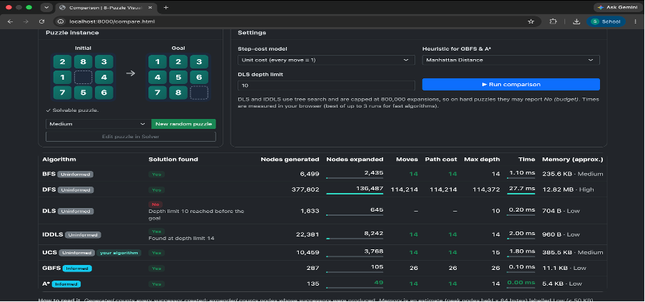

**Hard**
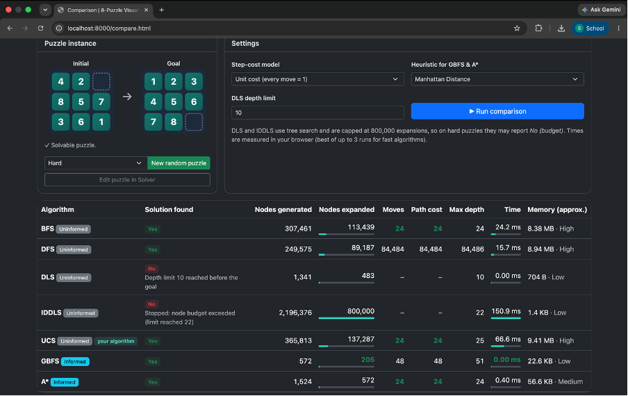

### 10. Tile-Weighted Cost Comparison
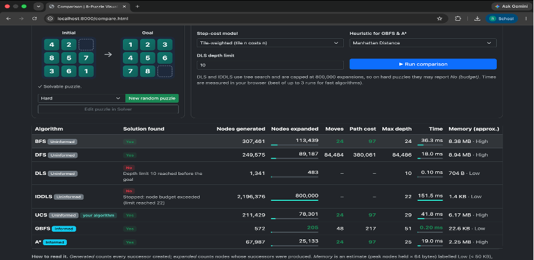

### 11. Search Algorithms Information
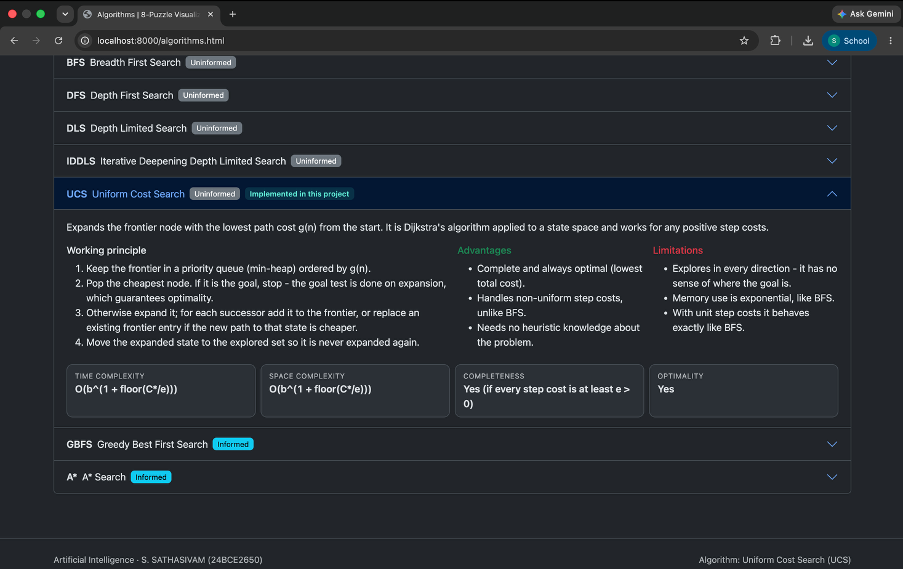

### 12. Interactive Controls
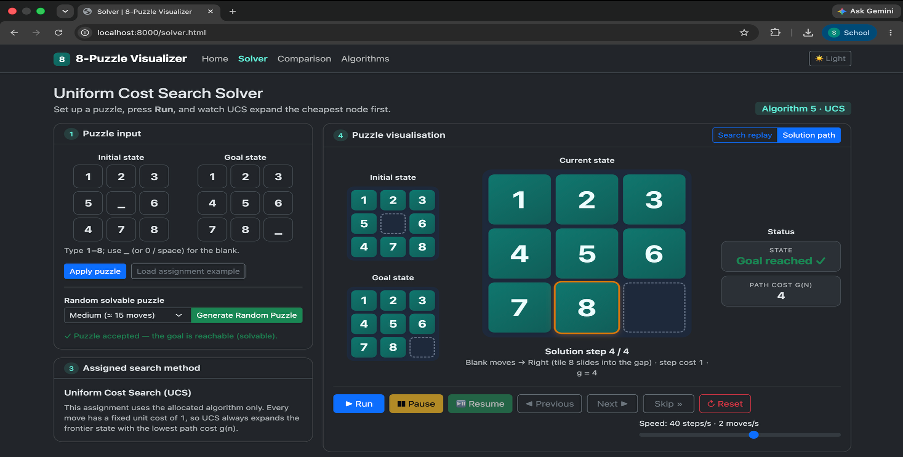

## Project Links

- **GitHub Repository:** https://github.com/dev-sathasivam18/AI-8Puzzle-Visualizer
- **Live Website:** https://dev-sathasivam18.github.io/AI-8Puzzle-Visualizer/
